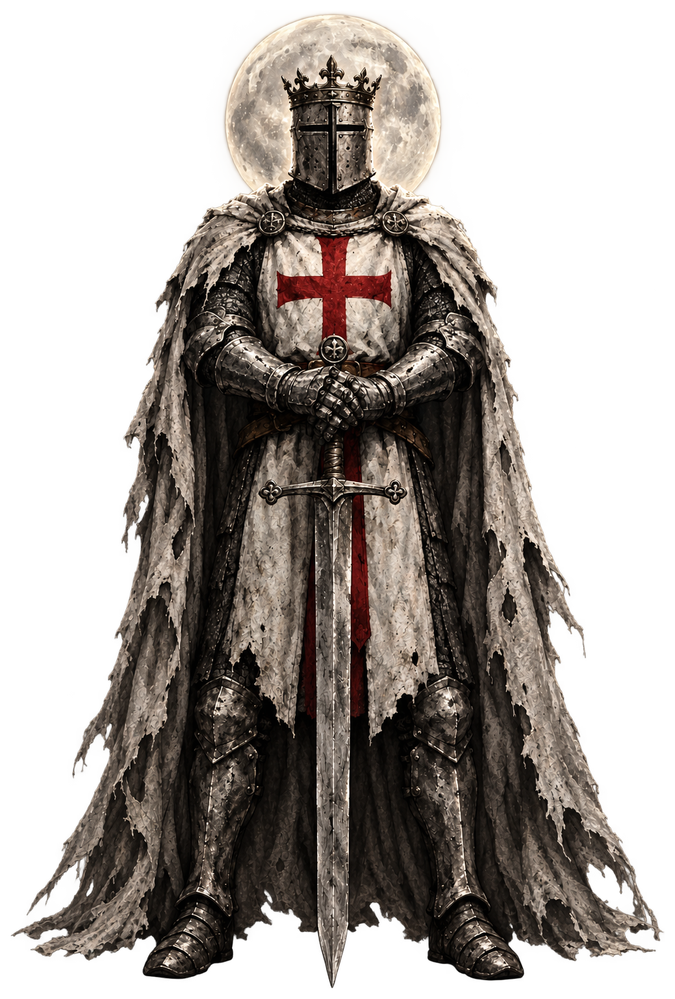

# Action Chess

**Chess, with a little more theater.**

An animated, Battle-Chess-inspired web project: real chess rules meet painted
Templar pieces and dramatic action.

<p align="center">
  
</p>

<p align="center"><em>The King</em></p>

## Take a look

- [King animation demo](public/king-demo.html)
- [Full army demo](public/army-demo.html)
- [Duel demo](public/duel-demo.html)
- [Game design notes](docs/game-design.md)

## Run locally

```sh
npm install
npm run dev
```

To create a production build:

```sh
npm run build
```
