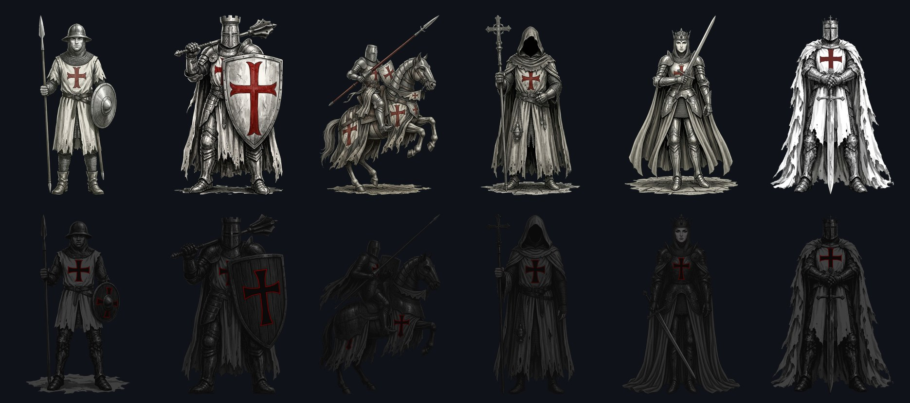
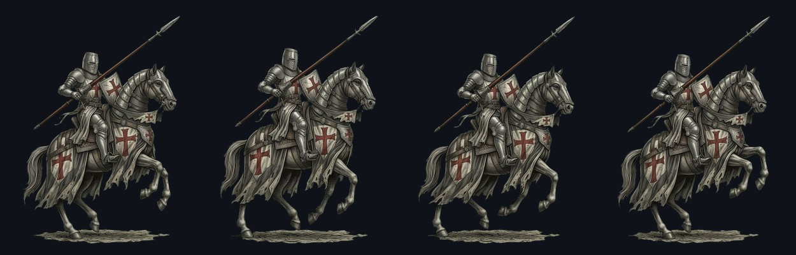
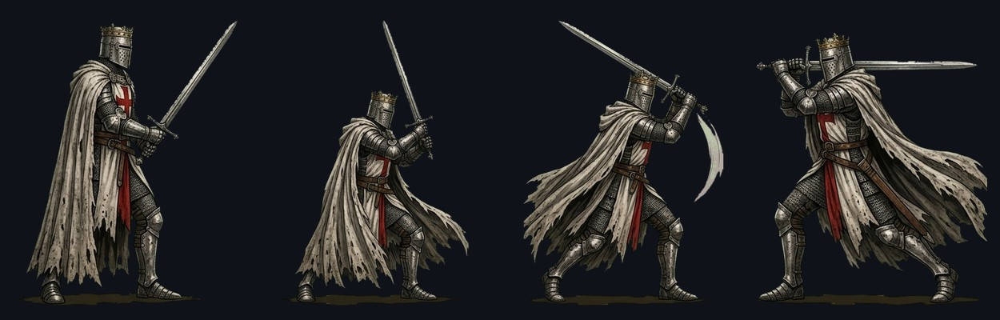
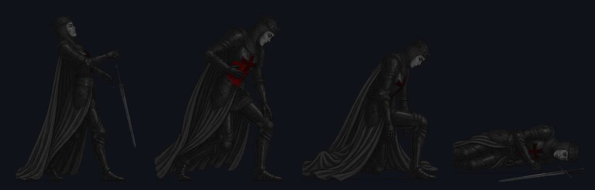

# Action Chess

**Real chess. Every move is a performance.**

Normal chess rules — but the pieces are painted crusader warriors who *walk* to
their square, and captures are fights: the attacker marches over, strikes, and
the loser plays a four-frame death before dissolving into embers.



Every piece has a real four-frame walk — animation frames, not a picture being
slid across the board:





## Play

**[Play it here →](https://uriz.github.io/action-chess/)**

Or run it locally:

```bash
npm install
npm run dev
```

Play Stockfish or hot-seat, pick a difficulty (Squire → Grandmaster), and set
the animation speed; clicking fast-forwards whatever is playing. **Fight cam**
zooms the camera in on each duel.

Other pages: `/army-demo.html`, `/duel-demo.html`, `/king-demo.html`.

## Art pipeline

The pieces are AI-generated, and the pipeline is **style-agnostic** — ask for a
Transformers army or a manga army and it produces a complete, coherent set.

```
Gemini (style-anchored chat)      tools/slice-sheet.py        public/pieces/
  idle portrait          green   chroma-key green     trans-   <color>-<piece>-
  walk / attack / death  ──────► inset cells, prune   ──────►  <action>-<n>.png
  sheets (2x2, 4 frames) screen  normalize + anchor   parent
```

`tools/faction-tint.py` then pushes the second army to a cold, dark palette so
the two sides read apart on the board.

```bash
/piece-forge Transformers-style boxy robots, glowing faction insignia
```

See `.claude/skills/piece-forge/` — its casting table is role-based (rook =
widest unit with a massive defensive feature, knight = the only mounted unit,
…), so any theme maps onto it without losing chess readability.

## How it works

`chess.js` is authoritative and resolves moves instantly; the board is a
skippable replay queue, so the game never waits for the animation. Stockfish
runs in a Web Worker and thinks while your piece is still walking. Plain DOM +
Web Animations, no game engine.

Design notes: [`docs/game-design.md`](docs/game-design.md).

## Layout

```
src/               game (board, engine, scenery, audio)
public/pieces/     game-ready transparent WebP
public/*.html      standalone demos
tools/             art extraction and palette scripts
art/generated/     raw AI output, kept so everything is re-derivable
.claude/skills/    piece-forge — the reusable art pipeline
```

## Credits

Art generated with Google Gemini; pipeline, tooling, animation and design built
with [Claude Code](https://claude.com/claude-code).
