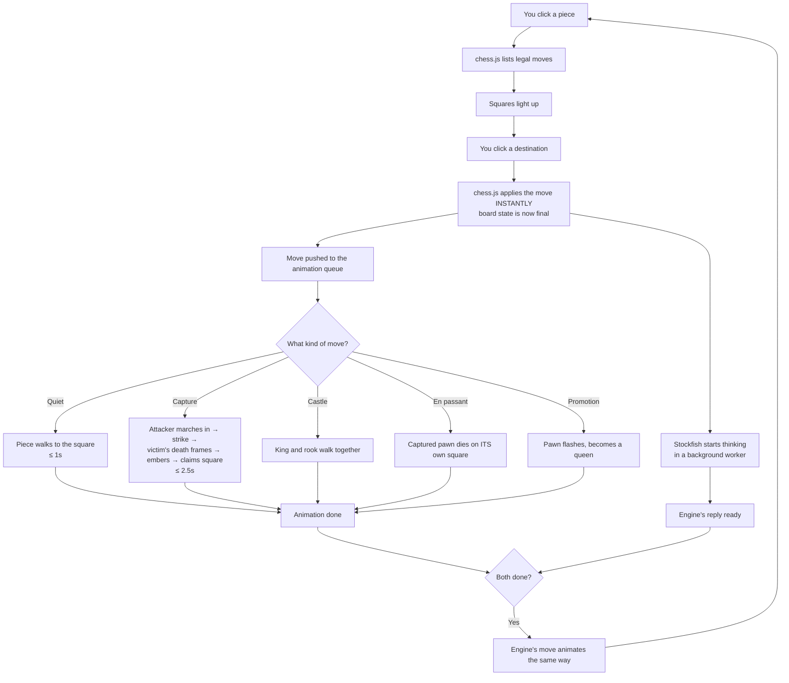

# Action Chess — Game Design

## TL;DR

**Real chess. Every move is a performance.**

You play normal chess against the computer (or a friend on the same screen).
The difference: pieces are painted warriors who **walk** to their square, and
captures are **fights** — the attacker marches over, strikes, the loser plays a
four-frame death and dissolves into embers.

Six decisions that define the build:

| # | Decision | Why |
|---|----------|-----|
| 1 | **The game never waits for the animation.** Chess logic resolves instantly; the animation is a replay. | A 60-move game can't make you watch 60 walk cycles before you can think. |
| 2 | **Fights happen on the board**, camera zooms to the square. | Keeps the position visible; no cutaway loading screens. |
| 3 | **Desktop web first.** | Where it looks best; mobile is a later pass. |
| 4 | **Plain HTML + CSS animations. No game engine.** | The demos already prove the feel in that stack. An engine adds 1.2 MB for nothing. |
| 5 | **Hard time budgets**: quiet move ≤ 1s, capture ≤ 2.5s, plus Fast/Instant modes and click-to-skip. | This is the single thing that kills Battle-Chess-likes. |
| 6 | **Opponent = Stockfish** (free chess engine, runs in the browser), with hot-seat 2-player too. | See "What is Stockfish?" below. |

---

## How a move flows

The key idea is the split in the middle: **E happens in a millisecond**, while
**F and G run side by side**. The engine thinks *while* your knight is still
walking, so its reply is usually ready the moment your animation ends — no
"computer is thinking" wait.

---

## Your questions, answered

### "What is Stockfish?"

Stockfish is the world's strongest chess engine — free, open-source, and the
same engine behind the analysis on chess.com and lichess. It compiles to
WebAssembly, so it runs **inside the browser tab**; no server, no account, no
cost. You give it a position, it gives back the best move.

Why it matters for us:
- **Difficulty is a dial.** It has a built-in skill level (0–20) and you can cap
  its thinking time. Level 1 plays like a beginner; level 20 beats grandmasters.
  That one setting gives us Easy/Normal/Hard for free.
- It runs in a **Web Worker** (a background thread), so its thinking never
  freezes the animation or the UI.
- Alternative if it fights us: a simple homemade AI (looks one or two moves
  ahead). Much weaker, but a fine placeholder behind the same interface.

### "Promotion — what? this is not clear?"

Chess rule: when a pawn reaches the far end of the board, it **transforms into a
stronger piece**. You almost always pick the queen (it's the most powerful), but
the rules let you choose rook, bishop, or knight instead — rare, but occasionally
it's the only way to avoid a stalemate or to fork with a knight.

The design question was just: *when your pawn gets there, do we pop up a menu
asking which piece, or silently give you a queen?*

**Recommendation: auto-queen** — no popup, the pawn flashes and becomes a queen.
It's what 99% of players want, and it keeps the flow unbroken. If you ever want
the choice, we add a settings toggle. (Visually: the pawn's death-style flash,
then the queen standee rises in its place.)

### Settled

- **Captures on the board** ✓ — camera zooms to the fighting square, no cutaway.
- **Web, desktop first** ✓ — mobile pass later.
- **Sound: keep the synthesized sfx** ✓ — footsteps, clangs, thuds, death drones,
  all generated in-browser, zero asset files.

---

## Architecture

Two layers that never blur together:

**Logic layer** — `chess.js` is the single source of truth. Legal moves,
check, checkmate, stalemate, castling rights, en passant, the 50-move rule: all
handled by a battle-tested library. Moves apply instantly and the board state is
always "ahead" of what you see.

**Presentation layer** — consumes a queue of move events and performs them. It
can be skipped, sped up, or (in Instant mode) reduced to a snap. It never feeds
anything back into the logic layer.

This split is what buys us: click-to-skip, speed settings, thinking during
animations, and the ability to rebuild the entire visual layer (a Transformers
reskin, say) without touching a line of chess code.

**Stockfish** lives in a Web Worker and starts thinking the moment your move is
applied — not when your animation ends.

---

## Board presentation

- **3/4 top-down view**: the board recedes slightly into the distance; pieces
  stand on it as upright painted figures (billboards), not flat-lying sprites.
- **Y-sorting by rank**: pieces on nearer ranks draw over farther ones, so
  overlap looks correct.
- **Slight scale gradient** (~12% smaller on the back rank) sells the depth.
- **Piece sizes** follow the ratios in `.claude/skills/piece-forge/SKILL.md`
  (§ Display-scale contract), scaled to tile size — pawn 0.85 of the king's
  height, knight widest for his horse, etc.
- **Idle art faces the camera**; walk/attack/death frames are side-view and get
  mirrored by travel direction, exactly as the demos do it.
- Dark moonlit aesthetic carried over from the demos: stars, moon, vignette,
  stone tiles.

---

## Move choreography

| Move type | What you see |
|---|---|
| **Quiet move** | Piece turns, walks its path with footstep frames, dust and footfall sounds, plants on arrival. ≤ 1s. |
| **Capture** | Attacker marches to striking range → wind-up (held beat) → strike with camera push-in, vignette, shake, clang → victim's 4 death frames → body lies → embers → attacker claims the square. ≤ 2.5s. |
| **Castling** | King and rook walk simultaneously, crossing paths. |
| **En passant** | Attacker steps diagonally; the captured pawn dies on *its own* square — the move that always confuses people, made visually obvious. |
| **Promotion** | Pawn flashes white, dissolves, queen standee rises in its place. |
| **Check** | The threatened king flinches and a red pulse rings his square. |
| **Checkmate** | Loser's king plays his full death sequence; board desaturates; victory banner. |

**Pacing controls**: Normal / Fast (≈60% durations) / Instant (pieces snap,
no animation). Click anywhere to fast-forward the current animation. The held
"menace" beats are the first thing Fast mode trims — the drama survives it.

---

## Tech stack

- **Vanilla TypeScript + Vite** (already installed). No React, no Phaser.
- **DOM + Web Animations API** for all animation — the duel demo proves this
  handles frame-swapping, camera moves, particles, and shake at 60fps.
- **chess.js** for rules; **stockfish.wasm** in a worker for the opponent.
- **WebAudio synth** for all sound (module already written in the demos).
- **Asset contract**: `public/pieces/<color>-<piece>.png` for idles,
  `<color>-<piece>-<action>-<n>.png` for frames. Black art falls back to a
  darkened white sprite while the black army is still being generated.

---

## Milestones

| # | Deliverable | Feel |
|---|---|---|
| **M1** | Board renders, pieces placed, click-to-move with legal highlights, instant (no animation) moves, check/mate detection, hot-seat. | A playable, ugly-but-correct chess game. |
| **M2** | Stockfish opponent + difficulty. | You can play a real game against the machine. |
| **M3** | Animation layer: walks and captures. | The reason this project exists. |
| **M4** | Specials: castling, en passant, promotion, check/mate sequences. | Complete chess, fully performed. |
| **M5** | Polish: speed settings, skip, sound pass, captured-piece tray, mobile layout. | Shippable. |

---

## Settled (round 2)

- **Board orientation** — the board **flips to your side**: your army is always
  the near, full-size rank. In hot-seat the board flips between turns.
- **Captured pieces** — **dissolve into embers**, exactly as the demos do now.
  No tray, no lingering corpses; the square clears for the attacker.
- **Difficulty** — **named tiers** mapped onto Stockfish skill levels:

  | Tier | Stockfish skill | Feel |
  |---|---|---|
  | Squire | 1 | learning the ropes |
  | Knight | 5 | a fair fight |
  | Crusader | 12 | a hard fight |
  | Grandmaster | 20 | you will lose |

Nothing in the design is open. Build order is M1 → M5 above.
